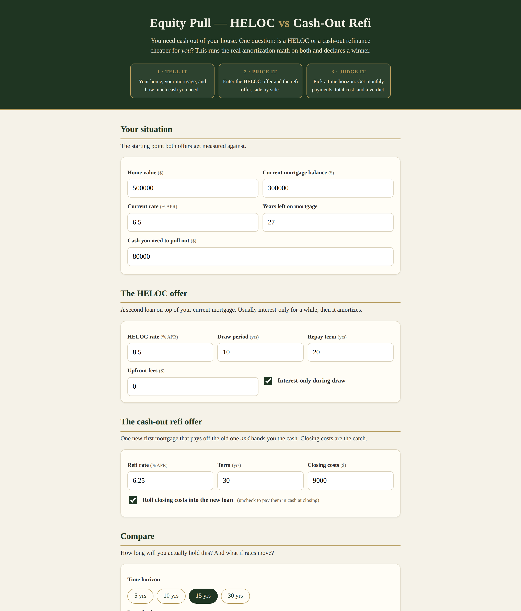

# Equity Pull — HELOC vs Cash-Out Refi

**Live app:** https://thebullbrew.github.io/heloc-vs-cashout-refi/

You need cash out of your house. One question: is a HELOC or a cash-out refinance cheaper for *you*?

## What it does

- **Your situation** — home value, current mortgage balance and rate, years left, and how much cash you need.
- **The HELOC offer** — rate, draw period, repayment term, interest-only option, upfront fees. Modeled honestly: interest-only during draw, then amortizing.
- **The cash-out refi offer** — rate, term, closing costs, with a toggle to roll costs into the loan or pay cash at closing.
- **The comparison** — pick a time horizon (5 / 10 / 15 / 30 years) and an optional ±1% rate shock.
- **The verdict** — side-by-side monthly payments, total extra-cost bars, a break-even month, and a plain-English winner ("The HELOC wins by $X over 10 years because…").
- **Saved comparisons** — name it, save it to your browser, come back later.

## The math, briefly

Both paths are measured against doing nothing (keeping your current mortgage). The refi's incremental cost is the new loan's payments minus the old loan's payments, plus closing costs. The HELOC's is the HELOC payments plus fees. Everything amortizes month by month — no shortcuts.

## Tech

Single self-contained page (`docs/index.html`), no backend, no build step, no secrets. Works offline as a PWA. Client-side only.

A word of straight talk: this is math, not advice. It assumes fixed rates and on-time payments, and ignores taxes, PMI, and the fact that HELOC rates usually float. Read your loan disclosures before you sign anything.
